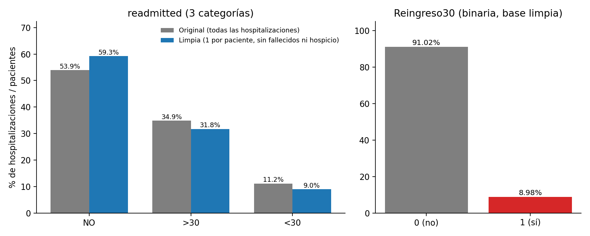
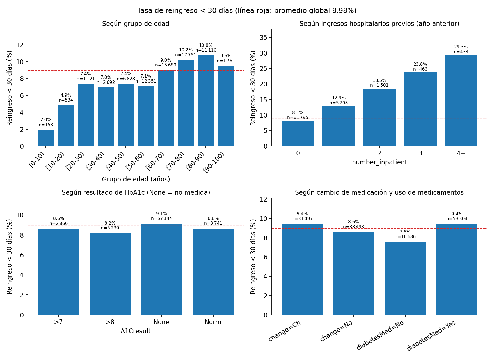
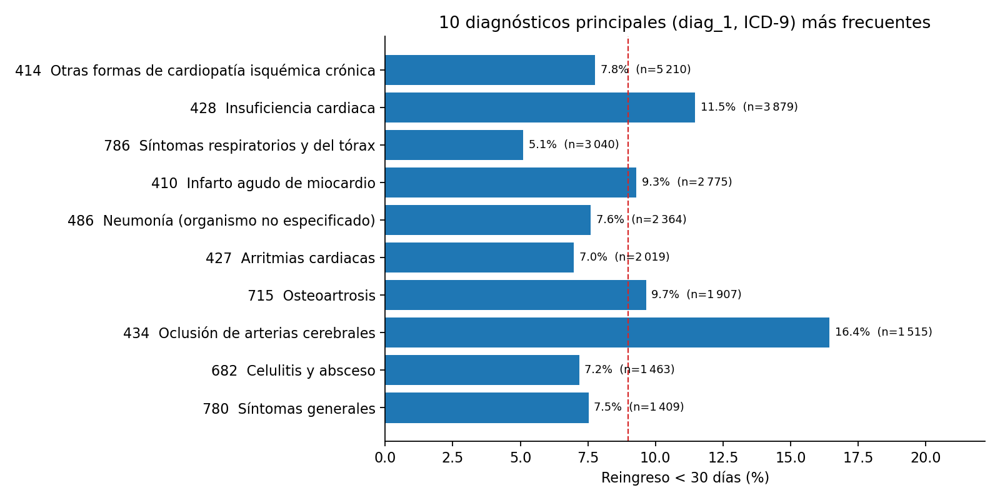
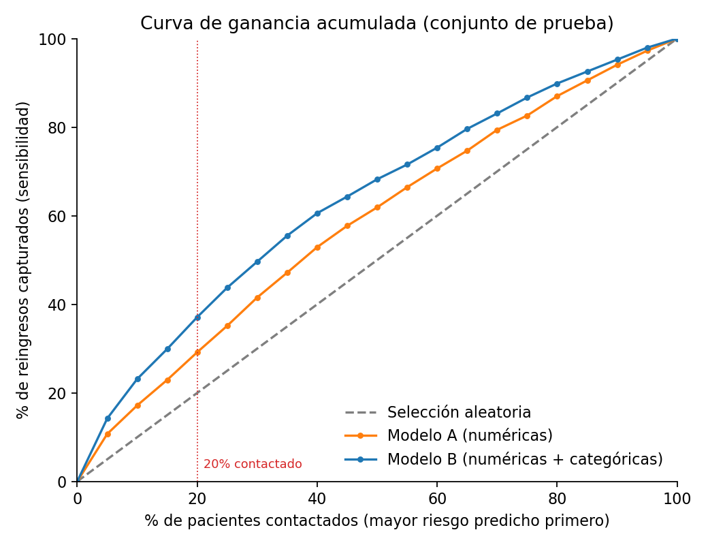
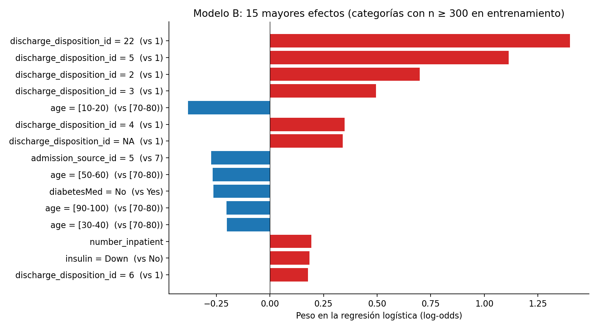
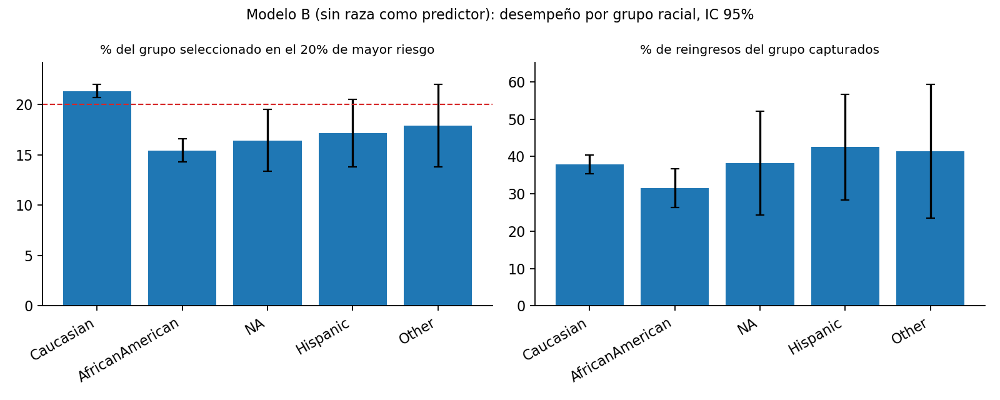

Reingresos de pacientes diabéticos en 130 hospitales de EE. UU

> **Cómo leer este reporte.** Todas las cifras y tablas se generan al ejecutar `bash scripts/pipeline.sh` (ver sección 8); este archivo se produce desde `report/reporte.md.tpl` y los valores que calcula el pipeline (`report/valores.env`, que se genera al ejecutarlo), por lo que no hay números escritos a mano. El informe técnico detallado está en `report/informe.pdf`.

## 1. Fuente y cita

Clore, J., Cios, K., DeShazo, J., & Strack, B. (2014). *Diabetes 130-US Hospitals for Years 1999-2008* [Conjunto de datos]. UCI Machine Learning Repository. <https://doi.org/10.24432/C5230J>

Estudio que describe el conjunto de datos: Strack, B., DeShazo, J. P., Gennings, C., Olmo, J. L., Ventura, S., Cios, K. J., & Clore, J. N. (2014). Impact of HbA1c measurement on hospital readmission rates: Analysis of 70,000 clinical database patient records. *BioMed Research International*, 2014, 781670. <https://doi.org/10.1155/2014/781670>

El archivo `diabetic_data.csv` contiene 101 766 hospitalizaciones de 71 518 pacientes con diagnóstico de diabetes en 130 hospitales de EE. UU. (1999–2008), con 50 columnas. La respuesta `readmitted` toma los valores `<30`, `>30` y `NO`.

**Datos sensibles.** Incluyen edad, sexo y raza. Por eso (i) el repositorio **no** contiene los datos: el pipeline los descarga desde UCI; (ii) la raza **no** se usa como predictor; y (iii) se audita el desempeño del modelo por grupo racial (sección 5).

## 2. Resumen de la limpieza

| paso | descripcion                                    | filas_antes | filas_despues | pacientes_unicos | columnas |
| ---- | ---------------------------------------------- | ----------- | ------------- | ---------------- | -------- |
| 0    | Archivo original (CRLF -> LF)                  | 101766      | 101766        | 71518            | 50       |
| A    | Recodificar faltantes como vacío               | 101766      | 101766        | 71518            | 50       |
| B    | Excluir fallecidos y cuidados paliativos       | 101766      | 99343         | 69990            | 50       |
| C    | Un registro por paciente (primer encounter_id) | 99343       | 69990         | 69990            | 50       |
| D    | Quitar columnas constantes y crear Reingreso30 | 69990       | 69990         | 69990            | 48       |

* **Terminadores de línea (CRLF).** `cat -A` muestra `^M$` al final de las líneas de `diabetic_data.csv` y de `IDS_mapping.csv`. Se normalizó con `tr -d '\r'`; si no, el último campo valdría `NO^M` o `<30^M` y cualquier comparación `readmitted=="<30"` fallaría sin avisar.
* **Diccionario `IDS_mapping.csv`.** Reúne tres tablas separadas por líneas `,`; se separó con `awk` en `data/mapa_admission_type_id.csv` (8 códigos), `data/mapa_discharge_disposition_id.csv` (30) y `data/mapa_admission_source_id.csv` (25). Algunas descripciones llevan comillas, comas internas o espacios sobrantes.
* **Faltantes.** El dato faltante se codifica como `?` (no hay celdas vacías en el original). Porcentaje de `?` en el archivo original: `weight` 96.86%, `medical_specialty` 49.08%, `payer_code` 39.56%, `race` 2.23%, `diag_3` 1.40%, `diag_2` 0.35%, `diag_1` 0.02%. Se recodificaron 192 849 celdas `?` como vacías.
* **`None` en los exámenes no es un dato faltante.** En `A1Cresult` (`>7`, `>8`, `Norm`, `None`) y `max_glu_serum` (`>200`, `>300`, `Norm`, `None`), `None` significa **examen no realizado** (84 748 y 96 420 hospitalizaciones; 83.28% y 94.75%). Es información clínica (el examen no se solicitó), por lo que se conserva como categoría y no se imputa. En las columnas de medicamentos, `No` significa «no prescrito».
* **Códigos del diccionario que en realidad son información ausente** (`NULL`, `Not Available`, `Not Mapped`, `Unknown/Invalid`), recodificados como vacío: 10 396 celdas de `admission_type_id`, 4 680 de `discharge_disposition_id` y 7 067 de `admission_source_id`.

| tabla                    | codigo | descripcion                                            | clase                 | filas_en_datos |
| ------------------------ | ------ | ------------------------------------------------------ | --------------------- | -------------- |
| admission_type_id        | 5      | Not Available                                          | ausente               | 4785           |
| admission_type_id        | 6      | NULL                                                   | ausente               | 5291           |
| admission_type_id        | 8      | Not Mapped                                             | ausente               | 320            |
| discharge_disposition_id | 11     | Expired                                                | fallecido_o_paliativo | 1642           |
| discharge_disposition_id | 13     | Hospice / home                                         | fallecido_o_paliativo | 399            |
| discharge_disposition_id | 14     | Hospice / medical facility                             | fallecido_o_paliativo | 372            |
| discharge_disposition_id | 18     | NULL                                                   | ausente               | 3691           |
| discharge_disposition_id | 19     | Expired at home. Medicaid only; hospice.               | fallecido_o_paliativo | 8              |
| discharge_disposition_id | 20     | Expired in a medical facility. Medicaid only; hospice. | fallecido_o_paliativo | 2              |
| discharge_disposition_id | 21     | Expired; place unknown. Medicaid only; hospice.        | fallecido_o_paliativo | 0              |
| discharge_disposition_id | 25     | Not Mapped                                             | ausente               | 989            |
| discharge_disposition_id | 26     | Unknown/Invalid                                        | ausente               | 0              |
| admission_source_id      | 9      | Not Available                                          | ausente               | 125            |
| admission_source_id      | 15     | Not Available                                          | ausente               | 0              |
| admission_source_id      | 17     | NULL                                                   | ausente               | 6781           |
| admission_source_id      | 20     | Not Mapped                                             | ausente               | 161            |
| admission_source_id      | 21     | Unknown/Invalid                                        | ausente               | 0              |

* **Categorías inválidas y columnas constantes.** `gender` tiene el valor inválido `Unknown/Invalid` en 3 filas (pasa a vacío). Se eliminaron tres columnas constantes: `examide` y `citoglipton` (constantes en el original) y `glimepiride-pioglitazone` (constante una vez filtradas las filas); no aportan información.
* **Exclusión de fallecidos y cuidados paliativos.** Se excluyeron 2 423 hospitalizaciones con alta por fallecimiento u hospicio (códigos 11, 13, 14, 19, 20 y 21, identificados en el diccionario por las descripciones `Expired` y `Hospice`). **Justificación, distinta para cada grupo:**
  * *Fallecimiento* (códigos 11, 19, 20 y 21; 1 652 hospitalizaciones): el paciente **no puede reingresar**, y los datos lo confirman: 0 tienen `readmitted = <30`. Dejarlos como «no reingreso» confundiría mortalidad con buena evolución.
  * *Hospicio* (códigos 13 y 14; 771 hospitalizaciones): aquí el reingreso **sí es posible**. 43 de ellas (5.58%) tienen `readmitted = <30`. Se excluyen porque el paciente pasa a cuidados de fin de vida: el objetivo clínico deja de ser evitar la hospitalización, el reingreso no es un resultado evitable que deba medir el programa y estos pacientes no son candidatos a un seguimiento cuyo fin es prevenirlo. Es el mismo criterio del estudio original de Strack et al. (2014).

| codigo | descripcion                                            | tipo          | filas_excluidas | con_reingreso_lt30 |
| ------ | ------------------------------------------------------ | ------------- | --------------- | ------------------ |
| 11     | Expired                                                | fallecimiento | 1642            | 0                  |
| 13     | Hospice / home                                         | hospicio      | 399             | 19                 |
| 14     | Hospice / medical facility                             | hospicio      | 372             | 24                 |
| 19     | Expired at home. Medicaid only; hospice.               | fallecimiento | 8               | 0                  |
| 20     | Expired in a medical facility. Medicaid only; hospice. | fallecimiento | 2               | 0                  |
| TOTAL  |                                                        |               | 2423            | 43                 |

* **Un registro por paciente** (la hospitalización con menor `encounter_id`). Se eliminaron 29 353 filas. **Justificación:** (1) las hospitalizaciones de un mismo paciente no son independientes —comparten edad, comorbilidades y conducta de consulta—; si quedaran repartidas entre entrenamiento y prueba habría **fuga de información** y las métricas serían optimistas; (2) el programa contacta *pacientes*, no hospitalizaciones; (3) los pacientes con muchas hospitalizaciones, que reingresan más, dominarían el archivo. **Costo:** se pierde información de los pacientes recurrentes y la primera hospitalización puede no ser representativa. *Nota de sensibilidad:* 1 545 pacientes tienen como primer encuentro un fallecimiento/paliativo; en 27 de ellos hay encuentros posteriores y, siguiendo el orden del enunciado (excluir y luego deduplicar), se conserva uno posterior (caso marginal: 0.04% de los pacientes).
* **`Reingreso30`** = 1 si `readmitted` es `<30` y 0 en otro caso (`>30` o `NO`). Resultado: `data/diab_clean.csv` con **69 990 filas y 48 columnas**.

## 3. Análisis exploratorio

### 3.1 Distribución de la respuesta

| base     | variable    | categoria | n     | porcentaje |
| -------- | ----------- | --------- | ----- | ---------- |
| original | readmitted  | <30       | 11357 | 11.16      |
| original | readmitted  | >30       | 35545 | 34.93      |
| original | readmitted  | NO        | 54864 | 53.91      |
| limpia   | readmitted  | <30       | 6285  | 8.98       |
| limpia   | readmitted  | >30       | 22226 | 31.76      |
| limpia   | readmitted  | NO        | 41479 | 59.26      |
| limpia   | Reingreso30 | 0         | 63705 | 91.02      |
| limpia   | Reingreso30 | 1         | 6285  | 8.98       |



En el archivo original, el 11.16% de las hospitalizaciones termina en reingreso en menos de 30 días (34.93% después de 30 días y 53.91% sin reingreso). Tras la limpieza, **la tasa de reingreso a 30 días es 8.98%** (6 285 de 69 990 pacientes): una clase positiva rara, con desbalance cercano a 1 a 10. Los dos pasos de limpieza mueven la tasa en sentidos opuestos. Excluir fallecidos y hospicio la **sube**, de 11.16% a 11.39% por hospitalización, porque casi todas esas altas tenían `readmitted = NO`. Dejar un registro por paciente la **baja** a 8.98%: en el original los pacientes recurrentes, que reingresan más, aportan muchas filas, y la primera hospitalización de cada paciente es, en promedio, de menor riesgo. `Reingreso30` colapsa `>30` y `NO` en una sola clase: mide el reingreso temprano, el que el programa de seguimiento busca evitar. El desbalance hace que la **exactitud sea una mala métrica**: predecir siempre «no reingreso» acierta 90.99% en el conjunto de prueba.

### 3.2 Datos faltantes: las cinco peores columnas

| columna             | faltantes | pct_faltante |
| ------------------- | --------- | ------------ |
| weight              | 67202     | 96.02        |
| medical_specialty   | 33654     | 48.08        |
| payer_code          | 30416     | 43.46        |
| admission_type_id   | 7893      | 11.28        |
| admission_source_id | 5069      | 7.24         |

* `weight` (96.02% faltante) es inutilizable. `medical_specialty` (48.08%) y `payer_code` (43.46%) faltan en casi la mitad de los registros y probablemente no al azar (dependen de cada hospital), por lo que no se usan como predictores.
* `admission_type_id` (11.28%) y `admission_source_id` (7.24%) tienen faltantes moderados; en el Modelo B se tratan como una categoría adicional `NA`.
* Los exámenes `A1Cresult` y `max_glu_serum` no se realizaron en 81.65% y 95.22% de los pacientes. Que el examen no se haga no es un dato faltante, pero sí limita lo que el resultado puede aportar: `A1Cresult` entra al Modelo B con `None` como categoría propia, y `max_glu_serum` no se usa.

### 3.3 Estadísticos descriptivos

| variable           | n     | media | desv_est | min | Q1   | mediana | Q3   | max |
| ------------------ | ----- | ----- | -------- | --- | ---- | ------- | ---- | --- |
| time_in_hospital   | 69990 | 4.27  | 2.93     | 1   | 2.0  | 3.0     | 6.0  | 14  |
| num_lab_procedures | 69990 | 42.88 | 19.89    | 1   | 31.0 | 44.0    | 57.0 | 132 |
| num_medications    | 69990 | 15.67 | 8.29     | 1   | 10.0 | 14.0    | 20.0 | 81  |
| number_diagnoses   | 69990 | 7.22  | 2.00     | 1   | 6.0  | 8.0     | 9.0  | 16  |

`time_in_hospital` y `num_medications` tienen cola derecha (media mayor que la mediana; máximos de 14 días y 81 medicamentos), mientras que `num_lab_procedures` y `number_diagnoses` tienen medias algo menores que sus medianas. La estadía mediana es 3.0 días (Q1–Q3: 2.0–6.0; máximo 14); se usan en promedio 15.67 medicamentos distintos (mediana 14.0) y 42.88 procedimientos de laboratorio, y se registran en promedio 7.22 diagnósticos.

### 3.4 Tasa de reingreso < 30 días según variables clave



| grupo_edad | n     | reingresos | tasa_pct |
| ---------- | ----- | ---------- | -------- |
| [0-10)     | 153   | 3          | 1.96     |
| [10-20)    | 534   | 26         | 4.87     |
| [20-30)    | 1121  | 83         | 7.40     |
| [30-40)    | 2692  | 188        | 6.98     |
| [40-50)    | 6828  | 506        | 7.41     |
| [50-60)    | 12351 | 880        | 7.12     |
| [60-70)    | 15689 | 1415       | 9.02     |
| [70-80)    | 17751 | 1817       | 10.24    |
| [80-90)    | 11110 | 1199       | 10.79    |
| [90-100)   | 1761  | 168        | 9.54     |

| ingresos_previos | n     | reingresos | tasa_pct |
| ---------------- | ----- | ---------- | -------- |
| 0                | 61795 | 5023       | 8.13     |
| 1                | 5798  | 747        | 12.88    |
| 2                | 1501  | 278        | 18.52    |
| 3                | 463   | 110        | 23.76    |
| 4+               | 433   | 127        | 29.33    |

| A1Cresult | n     | reingresos | tasa_pct |
| --------- | ----- | ---------- | -------- |
| >7        | 2866  | 247        | 8.62     |
| >8        | 6239  | 509        | 8.16     |
| None      | 57144 | 5206       | 9.11     |
| Norm      | 3741  | 323        | 8.63     |

| change | n     | reingresos | tasa_pct |
| ------ | ----- | ---------- | -------- |
| Ch     | 31497 | 2973       | 9.44     |
| No     | 38493 | 3312       | 8.60     |

| diabetesMed | n     | reingresos | tasa_pct |
| ----------- | ----- | ---------- | -------- |
| No          | 16686 | 1262       | 7.56     |
| Yes         | 53304 | 5023       | 9.42     |

### 3.5 Diez diagnósticos principales (`diag_1`, ICD-9)

| diag_1 | descripcion                                   | n    | reingresos | tasa_pct |
| ------ | --------------------------------------------- | ---- | ---------- | -------- |
| 414    | Otras formas de cardiopatía isquémica crónica | 5210 | 405        | 7.77     |
| 428    | Insuficiencia cardiaca                        | 3879 | 445        | 11.47    |
| 786    | Síntomas respiratorios y del tórax            | 3040 | 155        | 5.10     |
| 410    | Infarto agudo de miocardio                    | 2775 | 258        | 9.30     |
| 486    | Neumonía (organismo no especificado)          | 2364 | 180        | 7.61     |
| 427    | Arritmias cardiacas                           | 2019 | 141        | 6.98     |
| 715    | Osteoartrosis                                 | 1907 | 184        | 9.65     |
| 434    | Oclusión de arterias cerebrales               | 1515 | 249        | 16.44    |
| 682    | Celulitis y absceso                           | 1463 | 105        | 7.18     |
| 780    | Síntomas generales                            | 1409 | 106        | 7.52     |



*Nota.* La tabla usa los códigos de `diag_1` tal como vienen, que es lo que pide el enunciado. La diabetes misma (ICD-9 250.xx) no aparece porque está repartida en 34 subcódigos (250.8, 250.6, …). Agrupada en su categoría de tres caracteres suma 5 748 pacientes, con una tasa de 9.12%, y ocuparía el lugar 1 del ranking.

### 3.6 Tres hallazgos clave

1. **Las hospitalizaciones previas son el mayor gradiente de riesgo.** La tasa de reingreso sube de 8.13% (sin ingresos previos en el año anterior) a 12.88%, 18.52%, 23.76% y 29.33% con 1, 2, 3 y 4 o más (×3.6 entre extremos). Quienes tuvieron al menos un ingreso previo son solo el 11.71% de los pacientes pero concentran el 20.08% de los reingresos (fig. 2, tabla de ingresos previos).
2. **El riesgo aumenta con la edad.** Entre 20 y 59 años la tasa ronda 6.98–7.41%; sube a 9.02% a los 60–69 y alcanza 10.24% y 10.79% a los 70–79 y 80–89 años. Bajo los 20 años hay muy pocos casos (1.96% y 4.87%, con n = 153 y 534), por lo que esas tasas son inestables.
3. **El diagnóstico principal y el manejo de la diabetes separan menos que el historial.** Entre los diez diagnósticos más frecuentes la tasa va de 5.10% (síntomas respiratorios y del tórax, 786) a 16.44% (oclusión de arterias cerebrales, 434) y 11.47% (insuficiencia cardiaca, 428). Las variables de manejo de la diabetes asocian diferencias modestas (menos de 2 puntos): 9.42% con medicación vs 7.56% sin ella, 9.44% con cambio de medicación vs 8.60% sin cambio, y 9.11% cuando la HbA1c no se midió vs 8.16%–8.63% cuando sí se midió. Son asociaciones, no efectos causales.

## 4. Modelación predictiva con Vowpal Wabbit

**Diseño.** Modelos de regresión logística (`vw --loss_function logistic`, 10 pasadas, regularización L2 de 1e-6, semilla 42). *Modelo A*: ocho variables numéricas; *Modelo B*: A más `age`, `gender`, `admission_type_id`, `admission_source_id`, `discharge_disposition_id`, `A1Cresult`, `insulin`, `change` y `diabetesMed` (los códigos como categorías, no como números). Las numéricas se estandarizan con la media y desviación estándar del entrenamiento; las categóricas se codifican como `variable=valor`, con `NA` para los faltantes. La conversión CSV → formato `vw` se hace con `awk`. Partición 70/30 por paciente (una fila por paciente; se verifica con `comm` que ningún paciente está en ambos conjuntos): entrenamiento 48 993, prueba 20 997. Los pacientes de prueba se ordenan por probabilidad predicha y se evalúa el **20 % superior** (4 199 pacientes).

**Sobre la partición.** El enunciado propone `shuf --random-source=<(yes 42)`. Se verificó que esa fuente *no mezcla de forma uniforme* (el flujo `42\n42\n…` es periódico): el 32.04% del conjunto de prueba proviene del último decil del archivo ordenado por `encounter_id` (esperado: 10%), donde la tasa de reingreso es menor (5.59% frente a 9.67% en el primer decil). Resultado: tasa de reingreso de 9.44% en entrenamiento y 7.91% en prueba. Por eso la partición **principal** usa el mismo comando con una fuente pseudoaleatoria de calidad sembrada con 42 (generador Mersenne Twister de `python3`, `random.Random(42)`, que `shuf` consume como flujo de bytes): 8.97% vs 9.01%. La partición del enunciado se conserva como análisis de sensibilidad.

| decil_encounter_id | pct_test_yes42 | pct_test_principal | tasa_reingreso_pct |
| ------------------ | -------------- | ------------------ | ------------------ |
| 1                  | 6.18           | 9.82               | 9.67               |
| 2                  | 5.82           | 10.03              | 10.07              |
| 3                  | 1.59           | 10.05              | 9.87               |
| 4                  | 2.77           | 10.01              | 9.62               |
| 5                  | 5.82           | 10.09              | 10.46              |
| 6                  | 6.97           | 9.81               | 9.47               |
| 7                  | 4.52           | 10.29              | 9.04               |
| 8                  | 13.55          | 10.26              | 8.13               |
| 9                  | 20.75          | 9.83               | 7.87               |
| 10                 | 32.04          | 9.82               | 5.59               |

**¿Por qué el final del archivo tiene menos reingresos?** No es una tendencia temporal general. Con *todas* las hospitalizaciones la tasa de reingreso se mantiene estable entre deciles (10.80–12.31%); la caída aparece solo en la primera hospitalización de cada paciente. La explicación está en la ventana de observación. Los pacientes con más de una hospitalización registrada reingresan mucho más (20.53–30.98% en todos los deciles) que los que tienen una sola (2.25–6.17%). Un paciente que aparece por primera vez al final del período (2008) tiene menos tiempo para acumular hospitalizaciones dentro de los datos. En el último decil solo el 10.40% tiene otra hospitalización registrada, contra 16.37–31.92% en los demás. Una partición que concentra la prueba en ese decil evalúa el modelo en una población distinta de la de entrenamiento.

| decil_encounter_id | tasa_todas_hosp_pct | tasa_primera_hosp_pct | hosp_por_paciente | pct_con_otra_hosp | tasa_una_hosp_pct | tasa_varias_hosp_pct |
| ------------------ | ------------------- | --------------------- | ----------------- | ----------------- | ----------------- | -------------------- |
| 1                  | 11.11               | 9.67                  | 1.59              | 29.72             | 5.08              | 20.53                |
| 2                  | 12.12               | 10.07                 | 1.39              | 23.73             | 5.00              | 26.37                |
| 3                  | 12.03               | 9.87                  | 1.22              | 16.37             | 5.74              | 30.98                |
| 4                  | 10.95               | 9.62                  | 1.35              | 19.25             | 5.80              | 25.61                |
| 5                  | 12.31               | 10.46                 | 1.63              | 29.80             | 6.17              | 20.57                |
| 6                  | 11.45               | 9.47                  | 1.68              | 31.92             | 3.63              | 21.93                |
| 7                  | 11.02               | 9.04                  | 1.48              | 25.85             | 3.22              | 25.76                |
| 8                  | 11.16               | 8.13                  | 1.44              | 25.98             | 3.20              | 22.17                |
| 9                  | 10.93               | 7.87                  | 1.29              | 20.46             | 2.25              | 29.75                |
| 10                 | 10.80               | 5.59                  | 1.13              | 10.40             | 2.74              | 30.08                |

### 4.1 Resultados (conjunto de prueba, 20 % de mayor riesgo)

| modelo                         | capturados_top20 | reingresos_test | sensibilidad_pct | precision_pct | lift | auc   | exactitud_pct |
| ------------------------------ | ---------------- | --------------- | ---------------- | ------------- | ---- | ----- | ------------- |
| Selección aleatoria (esperado) | 378.4            | 1892            | 20.00            | 9.01          | 1.00 | 0.500 | -             |
| Modelo A                       | 552              | 1892            | 29.18            | 13.15         | 1.46 | 0.593 | 90.98         |
| Modelo B                       | 702              | 1892            | 37.10            | 16.72         | 1.86 | 0.648 | 90.97         |
| Siempre no reingreso           | 0                | 1892            | 0.00             | -             | -    | -     | 90.99         |

*Sensibilidad* = % de los reingresos de la prueba capturados entre los pacientes contactados; *precisión* = % de contactados que reingresan; *lift* = precisión / tasa global de la prueba (9.01%); *exactitud* evaluada con umbral 0.5. Si el 20% se elige **al azar**, la sensibilidad esperada es 20%; en 1000 selecciones aleatorias simuladas del 20% la sensibilidad media fue 19.97% (desviación estándar 0.86; rango 16.86–22.89%), de modo que ninguno de los dos modelos se parece al azar (A: 29.18%, B: 37.10%).



Intervalos de confianza del 95% (bootstrap de 1000 remuestras del conjunto de prueba, corte de score fijo). *Alcance:* estos intervalos reflejan solo la variabilidad del conjunto de prueba, con los modelos ya entrenados. No incluyen la variabilidad del entrenamiento (otra partición daría otros pesos), por lo que subestiman la incertidumbre total. La comparación con la partición del enunciado, más abajo, da una idea de esa otra fuente de variación.

| metrica                    | ic95_inf | mediana | ic95_sup |
| -------------------------- | -------- | ------- | -------- |
| sensibilidad_A             | 27.17    | 29.19   | 31.10    |
| sensibilidad_B             | 34.94    | 37.13   | 39.33    |
| lift_A                     | 1.36     | 1.46    | 1.55     |
| lift_B                     | 1.76     | 1.86    | 1.96     |
| dif_sensibilidad_B_menos_A | 5.79     | 7.95    | 10.11    |
| dif_lift_B_menos_A         | 0.30     | 0.40    | 0.50     |

Sensibilidad de la conclusión a la partición:

| particion | tasa_train_pct | tasa_test_pct | sens_A_pct | lift_A | sens_B_pct | lift_B |
| --------- | -------------- | ------------- | ---------- | ------ | ---------- | ------ |
| principal | 8.97           | 9.01          | 29.18      | 1.46   | 37.10      | 1.86   |
| enunciado | 9.44           | 7.91          | 27.59      | 1.38   | 34.46      | 1.72   |

## 5. Interpretación

**(i) ¿Qué modelo prioriza mejor y cuánto mejora respecto del azar?** El **Modelo B**: contactando al 20% de mayor riesgo captura 37.10% de los reingresos (702 de 1 892), con precisión 16.72% y *lift* 1.86, frente a 29.18% y 1.46 del Modelo A y a 20% / 1.00 del azar. Es decir, B captura 1.86 veces los reingresos que captura una selección aleatoria. La ventaja de B sobre A es de 7.95 puntos de sensibilidad (IC 95%: 5.79 a 10.11), con el intervalo completamente sobre cero. El AUC es 0.648 (B) y 0.593 (A): hay señal útil para priorizar, pero el poder discriminativo es modesto.

**(ii) ¿Por qué la exactitud es engañosa?** Porque solo ~8.98% de los pacientes reingresa: un «modelo» que siempre predice «no reingreso» logra 90.99% de exactitud sin identificar a ningún paciente de riesgo (sensibilidad 0%). Los Modelos A y B, evaluados con umbral 0.5, tienen 90.98% y 90.97%: prácticamente lo mismo, porque casi ninguna probabilidad supera 0.5 (solo 13 y 17 de 20 997 pacientes en A y B), aunque B ordena claramente mejor. La exactitud ignora el orden y el desbalance; en este problema importa la capacidad de *ranking* (sensibilidad, precisión y *lift* en el 20% superior).

**(iii) ¿Qué variables ponderan más y son clínicamente razonables?**

*Modelo B: pesos de las ocho variables numéricas (log-odds por una desviación estándar).*

| variable           | peso_por_DE |
| ------------------ | ----------- |
| time_in_hospital   | 0.053       |
| num_lab_procedures | 0.047       |
| num_procedures     | -0.007      |
| num_medications    | 0.000       |
| number_outpatient  | -0.002      |
| number_emergency   | 0.025       |
| number_inpatient   | 0.194       |
| number_diagnoses   | 0.073       |

*Modelo B: los 15 mayores efectos en valor absoluto, entre las variables numéricas y las categorías con al menos 300 pacientes en el entrenamiento. Las categorías se expresan como contraste con su categoría de referencia (la más frecuente).*

| variable                 | nivel    | descripcion                                    | referencia | n_train | peso   | tipo                     |
| ------------------------ | -------- | ---------------------------------------------- | ---------- | ------- | ------ | ------------------------ |
| discharge_disposition_id | 22       | Discharged/transferred to another rehab fac... | 1          | 971     | 1.399  | categórica vs referencia |
| discharge_disposition_id | 5        | Discharged/transferred to another type of i... | 1          | 645     | 1.114  | categórica vs referencia |
| discharge_disposition_id | 2        | Discharged/transferred to another short ter... | 1          | 1081    | 0.698  | categórica vs referencia |
| discharge_disposition_id | 3        | Discharged/transferred to SNF                  | 1          | 6172    | 0.495  | categórica vs referencia |
| age                      | [10-20)  |                                                | [70-80)    | 369     | -0.381 | categórica vs referencia |
| discharge_disposition_id | 4        | Discharged/transferred to ICF                  | 1          | 376     | 0.348  | categórica vs referencia |
| discharge_disposition_id | NA       |                                                | 1          | 2288    | 0.340  | categórica vs referencia |
| admission_source_id      | 5        | Transfer from a Skilled Nursing Facility (SNF) | 7          | 358     | -0.274 | categórica vs referencia |
| age                      | [50-60)  |                                                | [70-80)    | 8658    | -0.266 | categórica vs referencia |
| diabetesMed              | No       |                                                | Yes        | 11776   | -0.263 | categórica vs referencia |
| age                      | [90-100) |                                                | [70-80)    | 1235    | -0.203 | categórica vs referencia |
| age                      | [30-40)  |                                                | [70-80)    | 1856    | -0.201 | categórica vs referencia |
| number_inpatient         |          |                                                |            |         | 0.194  | numérica (por 1 DE)      |
| insulin                  | Down     |                                                | No         | 5035    | 0.185  | categórica vs referencia |
| discharge_disposition_id | 6        | Discharged/transferred to home with home he... | 1          | 5802    | 0.178  | categórica vs referencia |



Entre las numéricas (por desviación estándar), pesa más `number_inpatient` (0.194), seguida de `number_diagnoses` (0.073) y `time_in_hospital` (0.053): más hospitalizaciones previas, estadías largas y más diagnósticos —mayor complejidad clínica— aumentan el riesgo. Entre las categóricas, relativas al alta a domicilio, destacan el alta a **rehabilitación** (1.399), a otro tipo de **institución de cuidado** (1.114), a **otro hospital** (0.698) y a **centro de enfermería especializada (SNF)** (0.495), que son pacientes más frágiles; los pacientes de 10 a 19 años tienen menor riesgo (`age=[10-20)`: -0.381 frente a 70–79 años), igual que quienes no usan medicación para la diabetes (-0.263), y la insulina con dosis reducida (`Down`) se asocia a mayor riesgo (0.185). Los pesos de las numéricas (por desviación estándar) y los de las categorías (contraste con la categoría de referencia) no son directamente comparables entre sí. La mayoría de los efectos es clínicamente razonable, con dos matices. Primero, el peso de `time_in_hospital` baja de 0.119 en el Modelo A a 0.053 en el B: parte de su efecto lo recoge el destino al alta, porque las estadías largas terminan más a menudo en traslado a otra institución (estadía media de 5.56 días con alta a otra institución, contra 3.61 con alta a domicilio). El peso de una variable depende de qué otras incluye el modelo. Segundo, el ingreso desde un centro de enfermería especializada (`admission_source_id=5`) tiene peso negativo (-0.274), sin una explicación clínica evidente; puede reflejar cómo se registra ese origen, y no conviene interpretarlo. En todo caso son **asociaciones predictivas, no causales**, y las categorías raras (< 300 pacientes) no se interpretan.

**(iv) Efecto de usar varias hospitalizaciones del mismo paciente y cómo verificarlo.**

*Qué se espera.* Las hospitalizaciones de un mismo paciente están correlacionadas: misma edad, mismas comorbilidades, mismo historial de ingresos. Con una partición al azar por fila, el mismo paciente quedaría en entrenamiento y en prueba, y el modelo podría «reconocerlo». Esa **fuga de información** inflaría el AUC, la sensibilidad y el *lift*. Además, al contar como independientes datos que no lo son, se subestimaría la incertidumbre, y los pacientes con muchas hospitalizaciones pesarían más.

*Cómo se verificó.* Además de comprobar con `comm -12` que el análisis principal no comparte pacientes entre entrenamiento y prueba (0 compartidos), se hizo el experimento directo. Se tomaron todas las hospitalizaciones tras excluir fallecidos y hospicio (99 343, sin deduplicar) y se entrenó el mismo Modelo B con dos particiones 70/30 que solo difieren en *cómo* se reparte: **por fila** (cada hospitalización al azar) y **por paciente** (se sortean pacientes y todas sus hospitalizaciones van al mismo lado).

| escenario                                           | n_train | n_test | pct_test_paciente_en_train | tasa_test_pct | sensibilidad_B_pct | precision_B_pct | lift_B | auc_B |
| --------------------------------------------------- | ------- | ------ | -------------------------- | ------------- | ------------------ | --------------- | ------ | ----- |
| Una hospitalización por paciente (principal)        | 48993   | 20997  | 0.00                       | 9.01          | 37.10              | 16.72           | 1.86   | 0.648 |
| Todas las hospitalizaciones; partición por fila     | 69540   | 29803  | 39.00                      | 11.29         | 37.49              | 21.16           | 1.87   | 0.663 |
| Todas las hospitalizaciones; partición por paciente | 69483   | 29860  | 0.00                       | 11.64         | 36.93              | 21.50           | 1.85   | 0.657 |

*Resultado.* La fuga es real: con la partición por fila, el 39.00% de las hospitalizaciones de prueba pertenece a pacientes que también están en entrenamiento. Pero su efecto sobre este modelo es **pequeño**: AUC 0.663 contra 0.657 (diferencia 0.006) y sensibilidad 37.49% contra 36.93% (diferencia 0.56 puntos), dentro de la variación esperable de una sola partición. Tiene sentido: una regresión logística con 17 variables generales no puede memorizar pacientes individuales. La fuga sería mucho mayor con modelos flexibles (árboles, *boosting*) o con variables que identifiquen al paciente.

El efecto más importante de usar todas las hospitalizaciones es otro: **cambia la población evaluada**. La tasa de reingreso de la prueba sube de 9.01% (por paciente) a 11.64% (por hospitalización), y la precisión del 20% superior de 16.72% a 21.50%, porque los pacientes recurrentes aportan muchas filas. Esas cifras miden otra cosa: «hospitalizaciones contactadas», no «pacientes contactados». Mezclarlas sobreestimaría lo que el programa logra por cada paciente al que llama. Por eso el análisis principal usa un registro por paciente.

**(v) ¿Es apropiado usar la raza como predictor?** **No.** Aunque ninguno de los modelos la usa, conviene explicar por qué y qué ocurre sin ella. (a) La raza es un atributo protegido: usarla para decidir a quién se contacta puede generar trato desigual y riesgo legal y ético, y la asociación con reingreso refleja determinantes sociales (acceso, seguro, barrios) más que biología. (b) En los datos la raza falta en 2.23% de las hospitalizaciones y varios grupos son pequeños. (c) Aun sin raza, el modelo puede no ser neutral: con tasas de reingreso observadas de 9.20% en caucásicos y 8.36% en afroamericanos, el Modelo B incluye en el 20% de mayor riesgo al 21.33% de los caucásicos (IC 95%: 20.7-22.0) y al 15.45% de los afroamericanos (IC 95%: 14.3-16.6), una brecha estadísticamente clara, con intervalos disjuntos; y captura 37.88% (IC 95%: 35.4-40.4) de los reingresos de los primeros frente a 31.55% (26.4-36.7) de los segundos, una brecha no concluyente, con intervalos que se solapan.

(d) *¿De dónde viene la brecha de selección?* Coincide con diferencias de composición en las variables que más pesan en el modelo. En la prueba, el 29.26% de los pacientes afroamericanos tiene 70 años o más, contra 47.92% de los caucásicos. Tienen algún ingreso previo el 9.52% contra el 12.15%, y son dados de alta a otra institución (códigos 2, 3, 4, 5 y 22) el 14.55% contra el 20.11%. Entre los pacientes seleccionados, la **precisión es similar**: reingresa el 17.06% de los afroamericanos contactados (IC 95%: 14.0-20.1) y el 16.33% de los caucásicos (15.1-17.6), una diferencia no concluyente, con intervalos que se solapan. Es decir, entre los contactados la proporción que efectivamente reingresa es parecida en ambos grupos. La menor selección de pacientes afroamericanos coincide con que, en promedio, presentan menos de los factores de riesgo que el modelo usa. Estas variables pueden, a la vez, recoger diferencias de acceso a la atención: un menor registro de ingresos previos puede reflejar menos acceso y no menos riesgo. Con estos datos eso no se puede distinguir.

**Recomendación.** No usar la raza como predictor. Usarla **solo para auditar**: medir periódicamente, por grupo, la proporción seleccionada, la sensibilidad y la precisión. Si el comité quisiera además igualar la sensibilidad entre grupos, tendría que fijar cuotas o umbrales por raza, lo que en sí mismo es usar la raza para decidir a quién se llama. Esa es una decisión de política, con implicancias legales y éticas, que corresponde al comité y no al modelo; el análisis solo entrega la evidencia. Es un chequeo exploratorio, con grupos pequeños y un único conjunto de prueba.



| raza            | n     | pct_muestra | tasa_reingreso_pct | pct_seleccionado | ic95_seleccionado | sensibilidad_pct | ic95_sensibilidad | precision_pct |
| --------------- | ----- | ----------- | ------------------ | ---------------- | ----------------- | ---------------- | ----------------- | ------------- |
| Caucasian       | 15701 | 74.78       | 9.20               | 21.33            | 20.7-22.0         | 37.88            | 35.4-40.4         | 16.33         |
| AfricanAmerican | 3794  | 18.07       | 8.36               | 15.45            | 14.3-16.6         | 31.55            | 26.4-36.7         | 17.06         |
| NA              | 572   | 2.72        | 8.22               | 16.43            | 13.4-19.5         | 38.30            | 24.4-52.2         | 19.15         |
| Hispanic        | 478   | 2.28        | 9.83               | 17.15            | 13.8-20.5         | 42.55            | 28.4-56.7         | 24.39         |
| Other           | 335   | 1.60        | 8.66               | 17.91            | 13.8-22.0         | 41.38            | 23.5-59.3         | 20.00         |
| Asian           | 117   | 0.56        | 6.84               | 23.93            | 16.2-31.7         | 62.50            | 29.0-96.0         | 17.86         |

*Composición de los pacientes de prueba por raza* (variables de mayor peso del Modelo B) *y precisión entre los seleccionados:*

| raza            | n     | edad_70_o_mas_pct | ingreso_previo_pct | alta_a_institucion_pct | tasa_reingreso_pct | pct_seleccionado | precision_pct | ic95_precision |
| --------------- | ----- | ----------------- | ------------------ | ---------------------- | ------------------ | ---------------- | ------------- | -------------- |
| Caucasian       | 15701 | 47.92             | 12.15              | 20.11                  | 9.20               | 21.33            | 16.33         | 15.1-17.6      |
| AfricanAmerican | 3794  | 29.26             | 9.52               | 14.55                  | 8.36               | 15.45            | 17.06         | 14.0-20.1      |
| NA              | 572   | 40.91             | 8.04               | 18.71                  | 8.22               | 16.43            | 19.15         | 11.2-27.1      |
| Hispanic        | 478   | 26.15             | 13.81              | 12.97                  | 9.83               | 17.15            | 24.39         | 15.1-33.7      |
| Other           | 335   | 31.64             | 10.45              | 14.63                  | 8.66               | 17.91            | 20.00         | 9.9-30.1       |
| Asian           | 117   | 54.70             | 10.26              | 21.37                  | 6.84               | 23.93            | 17.86         | 3.7-32.0       |

## 6. Conclusión y recomendación al comité

* **Recomendación:** usar el **Modelo B** para priorizar el seguimiento telefónico. Contactar al 20% de pacientes con mayor riesgo predicho captura **37.10%** de los reingresos a 30 días, **1.86 veces** lo que se lograría al azar (IC 95% del *lift*: 1.76–1.96).
* **Alcance honesto:** el AUC de 0.648 indica que el modelo ordena a los pacientes solo moderadamente bien: el 62.90% de los reingresos queda fuera del 20% contactado. Se recomienda complementarlo con reglas simples y trazables (ingresos previos y alta a una institución de cuidado) y evaluar su desempeño en datos más recientes.
* **Equidad y privacidad:** no usar la raza como predictor, sino solo para auditar. Monitorear por grupo la proporción seleccionada, la sensibilidad y la precisión: hoy se selecciona a una menor proporción de pacientes afroamericanos, con una precisión similar. Si se decide intervenir, que lo resuelva el comité como decisión explícita de política. No distribuir los datos de pacientes fuera del entorno autorizado.
* **Limitaciones:** un solo conjunto de prueba (sin validación cruzada ni validación temporal); intervalos bootstrap que solo recogen la variabilidad de la prueba; modelo lineal sin interacciones ni ajuste fino de hiperparámetros; datos de 1999–2008; solo reingresos observados en estos hospitales; ventana de observación más corta para los pacientes vistos por primera vez al final del período; análisis restringido a la primera hospitalización de cada paciente.

## 7. Ficha de seguimiento post-alta

Generada por el pipeline (`report/ficha.txt`) con comandos sobre `data/diab_clean.csv` y `data/test_pred.csv` (Modelo B, partición principal):

```text
Comite de Calidad - Ficha de Seguimiento Post-Alta
Analista: piasa
Pacientes analizados: 69990
Reingreso en <30 dias: 8.98%
Reingresos capturados contactando al 20%: 37.10%
Lift del modelo: 1.86
```

## 8. Reproducibilidad

```bash
git clone https://github.com/trini-tini/evaluacion1-diabetes && cd evaluacion1-diabetes
# dentro del contenedor datasciencetoolbox/dsatcl2e (o una terminal Linux con las herramientas indicadas)
bash scripts/pipeline.sh
```

Estructura: `scripts/` (`pipeline.sh`, `graficos.py`, `csv2tex.py`), `data/` (datos y tablas intermedias; se genera y no se versiona), `report/` (`reporte.md`, `ficha.txt`, `informe.tex`, `informe.pdf`, `figuras/`). Rutas relativas a la raíz del repositorio. Semillas: 42 (partición, `vw`, simulaciones).

**Verificación del texto.** Las afirmaciones cualitativas de este reporte dependen de los números: el orden de los pesos, sus signos, si una tasa «sube» o «baja». Por eso el pipeline las comprueba una a una contra los valores calculados (`data/tablas/verificacion_texto.csv`, que se genera al ejecutarlo) y avisa si alguna deja de cumplirse, por ejemplo con otra versión de `vw`. En esta ejecución se cumplen **31 de 31**.

**Validación entre entornos.** El pipeline se ejecutó desde cero, con descarga incluida, en dos entornos con versiones distintas de las herramientas: el contenedor `datasciencetoolbox/dsatcl2e` (`vw` 8.11, `shuf` 8.32, `mawk`, Python 3.9) y Ubuntu 24.04 en WSL (`vw` 8.6.1, `shuf` 9.4, `gawk`, Python 3.12). Todas las tablas, `data/diab_clean.csv` y `report/valores.env` resultaron idénticos byte a byte, y se cumplieron las mismas verificaciones. Las probabilidades de `vw` difieren solo en la sexta cifra decimal (menos de 0.00001), sin cambiar el orden de los pacientes ni ninguna métrica. Lo único que cambia es la línea `Analista` de la ficha, que toma el usuario que ejecuta (`whoami`).

Entorno de la última ejecución:

```text
fecha: 2026-10-22 18:50
sistema: Linux 6.18.33.1-microsoft-standard-WSL2
bash: 5.2.21(1)-release
awk: GNU Awk 5.2.1, API 3.2, PMA Avon 8-g1, (GNU MPFR 4.2.1, GNU MP 6.3.0)
shuf: shuf (GNU coreutils) 9.4
vw: 8.6.1
csvkit: csvstat 1.4.0
python3: Python 3.12.3 / matplotlib 3.6.3
```
